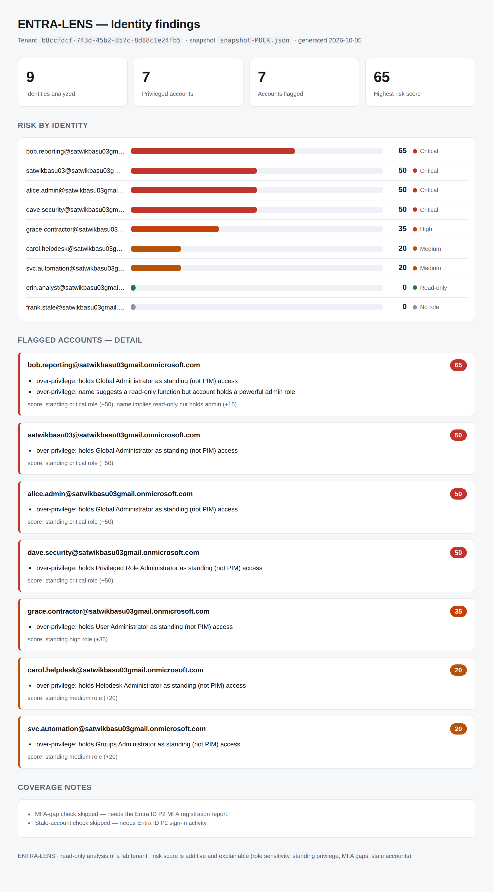

# ENTRA-LENS — Identity & Least-Privilege Governance for Microsoft Entra ID

Find risky identities, score them, and enforce least privilege as code — the
day-to-day loop of a cloud security engineer, built end to end against a real Entra
ID tenant.



## What it does

```
collector.py   →   analyzer.py   →   dashboard.py        Terraform
(read tenant)      (score risk)      (HTML report)        (enforce as code)
     │                  │                  │                   │
  snapshot          findings          live dashboard      Conditional Access
  (read-only)       + report          (GitHub Pages)      + right-sized roles
                                                          (Checkov-gated)
```

1. **Collect** — a read-only Microsoft Graph client snapshots the tenant: users,
   directory roles, role assignments, service principals, and (on premium tenants)
   sign-in and audit logs.
2. **Analyze** — an explainable engine scores each identity 0–100 on role
   sensitivity, standing (non-PIM) privilege, MFA gaps, and stale accounts, and
   flags over-privilege — while **leaving correctly-scoped read-only accounts alone**.
3. **Report** — findings go to a Markdown report and a self-contained HTML
   dashboard; a scheduled GitHub Action republishes it to a public URL.
4. **Enforce as code** — Terraform provisions least-privilege access and (on a
   licensed tenant) Conditional Access requiring MFA for admins and blocking legacy
   auth, gated by Checkov in CI.

The through-line: **find → fix → prove**, with the scanner guarding the fix.

## Why it's built this way

- **Read-only by default.** Collection uses only read scopes; the write permissions
  exist solely for one-time lab seeding and are removed afterward.
- **Explainable scoring.** Every risk score shows its additive factors, so a finding
  can be defended, not just asserted.
- **Graceful degradation.** MFA-gap and stale-account checks need Entra ID P1/P2;
  on a free tenant they are clearly marked skipped and the rest still runs.
- **Passwordless CI.** The live dashboard authenticates via OIDC federation — no
  secret is stored anywhere.

## Components

| File | Role |
|---|---|
| `graph_client.py` | Minimal Graph client (OAuth2 client-credentials or CI OIDC token; paging; throttling) |
| `collector.py` | Read-only tenant snapshot → `snapshots/` |
| `analyzer.py` | Risk scoring and findings → `reports/report-*.md`, `reports/findings-*.json` |
| `dashboard.py` | Self-contained HTML dashboard → `reports/dashboard-*.html` |
| `seed.py` | One-time lab seeder (planted over-privilege, no-MFA, stale, standing-privilege cases) |
| `terraform/` | Conditional Access + right-sized role assignment as code |
| `.github/workflows/terraform.yml` | fmt + validate + Checkov gate on the IaC |
| `.github/workflows/live-dashboard.yml` | Scheduled OIDC scan → GitHub Pages |

## Run it locally

```bash
python -m venv .venv && source .venv/bin/activate   # Windows: .venv\Scripts\activate
pip install -r requirements.txt
cp .env.example .env            # fill in TENANT_ID / CLIENT_ID / CLIENT_SECRET

python seed.py                  # one-time: populate a lab tenant (needs write scopes)
python collector.py             # read-only snapshot
python analyzer.py              # findings report
python dashboard.py             # HTML dashboard -> open reports/dashboard-*.html
```

Full tenant/app setup is in the per-phase docs. Terraform is in
[`terraform/README.md`](terraform/README.md); the live dashboard in
[`LIVE-DASHBOARD.md`](LIVE-DASHBOARD.md).

## Results on the lab tenant

9 identities analyzed, 7 privileged, 7 flagged. `bob.reporting` (Global Admin on a
reporting account) tops the list at risk 65; the Global Reader control account is
correctly left clean. Terraform provisioned a least-privilege reader account; the
Conditional Access policies are validated with `terraform plan` (their `apply`
requires a P1/P2 licence).

## Tech

Python · Microsoft Graph API · Terraform (azuread) · Checkov · GitHub Actions ·
OIDC federation · GitHub Pages

## Security & scope

A lab project against a throwaway Entra tenant with **synthetic** users. Collection
is read-only; the published dashboard masks the tenant domain; `.env`, snapshots and
Terraform state are git-ignored and never committed.
